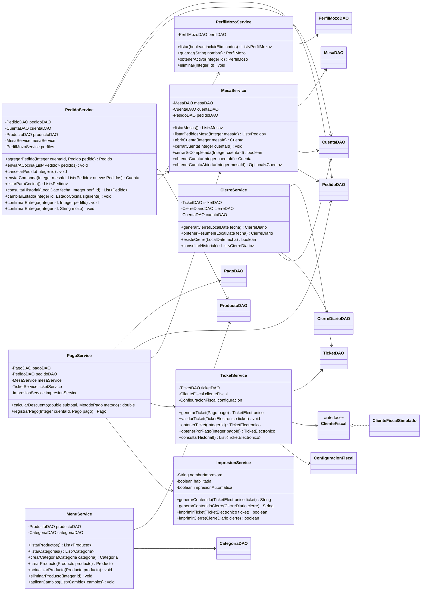

# UML de servicios - TrabajoTP_Martes

Vista resumida de la capa de servicios y sus dependencias principales. Esta separada del [UML completo del modelo](UML.md): los servicios coordinan los casos de uso y utilizan entidades y DAO, pero no son entidades del negocio.

No se detallan aqui todos los miembros de cada servicio. Se omiten constructores, accesores y dependencias transversales del dibujo para facilitar la lectura. Los nombres y operaciones mostrados existen en el codigo.

[Abrir el diagrama de servicios en SVG para ampliarlo](diagramas/servicios.svg).

`Clock` permite obtener fechas y horas de forma controlada. `OperacionGuard` coordina operaciones transaccionales. Ambas son dependencias adicionales de varios servicios y se omiten del dibujo resumido.

Los DAO y el cliente fiscal aparecen como colaboradores, no como parte del modelo. `Cambio` es un record interno de `MenuService`, no una entidad persistida. La sobrecarga `confirmarEntrega(Integer, String)` mantiene compatibilidad con solicitudes antiguas; la interfaz actual utiliza el identificador del perfil.
