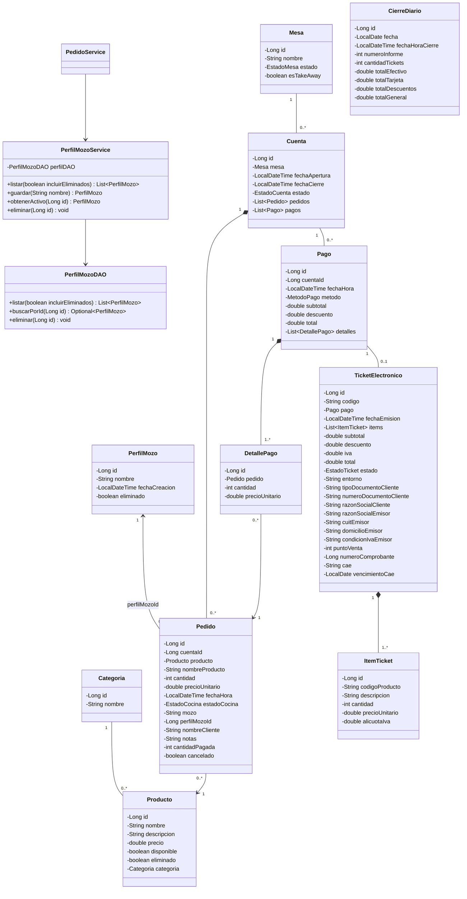
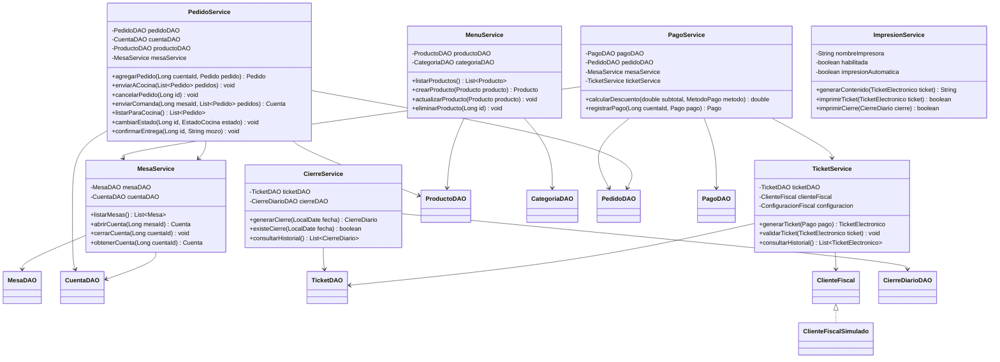

# UML de la version Java

Los tipos corresponden a la implementacion. Se omiten getters/setters para facilitar la lectura. Cuenta representa una atencion de una mesa, no un usuario.

## Servicios

Clock y OperacionGuard son dependencias adicionales de los servicios que realizan operaciones transaccionales. PagoService tambien utiliza ImpresionService despues de guardar el pago.
