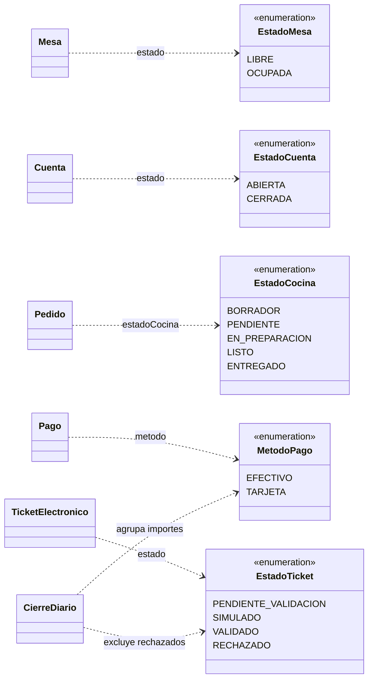
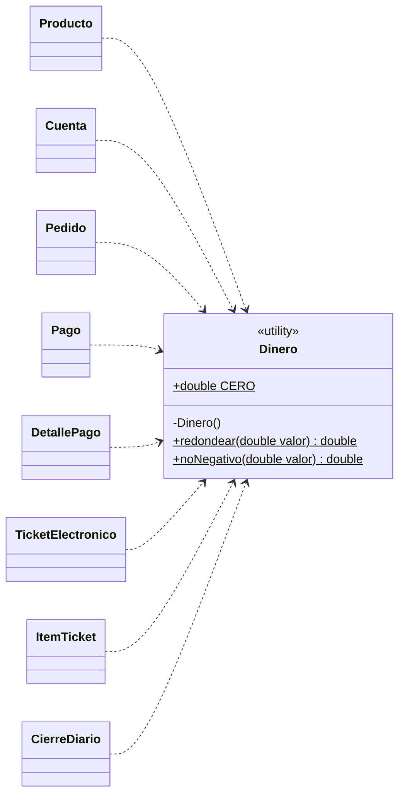

# UML completo del modelo - TrabajoTP_Martes

Este documento describe las clases del paquete `ar.edu.cafe.model` tal como estan implementadas. Incluye todos sus atributos y metodos propios, sin getters ni setters. No se agregan operaciones que todavia no existen en el codigo.

El modelo y los servicios pertenecen a capas diferentes. Aqui se muestran las entidades, los estados y la utilidad monetaria del modelo. Los servicios y sus dependencias estan separados en [UML-Servicios.md](UML-Servicios.md).

## 1. Como leer el diagrama

| Simbolo | Significado |
| --- | --- |
| `-` | Miembro privado. |
| `+` | Miembro publico. |
| `$` al final de un miembro | Atributo o metodo estatico. |
| `1` | Exactamente uno. |
| `0..1` | Cero o uno. |
| `0..*` | Cero o muchos. |
| `1..*` | Uno o muchos. |
| `-->` | Asociacion navegable hacia la clase indicada. |
| `*--` | Composicion: el detalle pertenece conceptualmente a su contenedor. |
| `..>` | Dependencia: una clase utiliza otra, sin necesariamente conservarla como atributo. |

En Mermaid, `List~Pedido~` representa `List<Pedido>`. Los constructores implicitos no se detallan. Se muestran las multiplicidades del negocio para operaciones validas; un objeto recien creado puede tener listas vacias antes de registrarse.

## 2. Entidades del negocio

Son once clases. `Cuenta` representa una atencion de una mesa, no un usuario ni un perfil de mozo.

[Abrir el diagrama de entidades en SVG para ampliarlo](diagramas/modelo-entidades.svg).

```mermaid
classDiagram
    direction LR
    class Mesa {
        -Long id
        -String nombre
        -EstadoMesa estado
        -boolean esTakeAway
        +ocupar() void
        +liberar() void
        +estaLibre() boolean
    }
    class Categoria {
        -Long id
        -String nombre
        +cambiarNombre(String nombre) void
    }
    class Producto {
        -Long id
        -String nombre
        -String descripcion
        -double precio
        -boolean disponible
        -boolean eliminado
        -Categoria categoria
        +actualizarPrecio(double precio) void
        +cambiarDisponibilidad(boolean disponible) void
    }
    class PerfilMozo {
        -Long id
        -String nombre
        -LocalDateTime fechaCreacion
        -boolean eliminado
    }
    class Pedido {
        -Long id
        -Long cuentaId
        -Producto producto
        -String nombreProducto
        -int cantidad
        -double precioUnitario
        -LocalDateTime fechaHora
        -EstadoCocina estadoCocina
        -String mozo
        -Long perfilMozoId
        -String nombreCliente
        -String notas
        -int cantidadPagada
        -boolean cancelado
        +calcularSubtotal() double
        +aumentarCantidad(int cantidad) void
        +cambiarEstadoCocina(EstadoCocina estado) void
        +obtenerCantidadPendienteDePago() int
        +registrarCantidadPagada(int cantidad) void
        +cancelar() void
    }
    class Cuenta {
        -Long id
        -Mesa mesa
        -LocalDateTime fechaApertura
        -LocalDateTime fechaCierre
        -EstadoCuenta estado
        -List~Pedido~ pedidos
        -List~Pago~ pagos
        +agregarPedido(Pedido pedido) void
        +calcularSubtotal() double
        +obtenerPedidosPendientesDePago() List~Pedido~
        +estaSaldada() boolean
        +cerrar() void
    }
    class DetallePago {
        -Long id
        -Pedido pedido
        -int cantidad
        -double precioUnitario
        +calcularImporte() double
    }
    class Pago {
        -Long id
        -Long cuentaId
        -LocalDateTime fechaHora
        -MetodoPago metodo
        -double subtotal
        -double descuento
        -double total
        -List~DetallePago~ detalles
        +calcularSubtotal() double
        +aplicarDescuento(double importe) void
        +calcularTotal() double
    }
    class ItemTicket {
        -Long id
        -String codigoProducto
        -String descripcion
        -int cantidad
        -double precioUnitario
        -double alicuotaIva
        +calcularImporte() double
        +calcularIva() double
    }
    class TicketElectronico {
        -Long id
        -String codigo
        -Pago pago
        -LocalDateTime fechaEmision
        -List~ItemTicket~ items
        -double subtotal
        -double descuento
        -double iva
        -double total
        -EstadoTicket estado
        -String entorno
        -String tipoDocumentoCliente
        -String numeroDocumentoCliente
        -String razonSocialCliente
        -String razonSocialEmisor
        -String cuitEmisor
        -String domicilioEmisor
        -String condicionIvaEmisor
        -int puntoVenta
        -Long numeroComprobante
        -String cae
        -LocalDate vencimientoCae
        +calcularTotales() void
        +registrarAutorizacion(Long numero, String cae, LocalDate vencimiento) void
        +registrarRechazo() void
    }
    class CierreDiario {
        -Long id
        -LocalDate fecha
        -LocalDateTime fechaHoraCierre
        -int numeroInforme
        -int cantidadTickets
        -double totalEfectivo
        -double totalTarjeta
        -double totalDescuentos
        -double totalGeneral
        +calcularResumen(List~TicketElectronico~ tickets) void
    }
    Mesa "1" <-- "0..*" Cuenta : mesa
    Cuenta "1" *-- "0..*" Pedido : pedidos y cuentaId
    Categoria "1" <-- "0..*" Producto : categoria
    Pedido "0..*" --> "1" Producto : producto
    PerfilMozo "1" <-- "0..*" Pedido : perfilMozoId
    Cuenta "1" --> "0..*" Pago : pagos y cuentaId
    Pago "1" *-- "1..*" DetallePago : detalles
    DetallePago "0..*" --> "1" Pedido : pedido
    TicketElectronico "0..1" --> "1" Pago : pago
    TicketElectronico "1" *-- "1..*" ItemTicket : items
    CierreDiario ..> TicketElectronico : calcularResumen
```

### Aclaraciones sobre las relaciones

| Relacion | Interpretacion y correspondencia con el codigo |
| --- | --- |
| Mesa - Cuenta | Cada cuenta tiene una `Mesa`. Una mesa puede acumular cuentas historicas, pero solo puede tener una abierta a la vez. `Mesa` no guarda una lista de cuentas. |
| Cuenta - Pedido | `Cuenta.pedidos` agrupa sus pedidos; cada pedido conserva `cuentaId`, no un atributo `Cuenta cuenta`. |
| Categoria - Producto | Cada producto guarda su `Categoria`. Una categoria puede tener muchos productos. |
| Pedido - Producto | Un pedido corresponde a un producto y puede representar varias unidades mediante `cantidad`. |
| PerfilMozo - Pedido | La referencia se guarda como `perfilMozoId`, no como un objeto `PerfilMozo`. Los pedidos nuevos requieren un perfil activo. |
| Cuenta - Pago | `Cuenta.pagos` permite pagos parciales sucesivos. `Pago` conserva `cuentaId`. |
| Pago - DetallePago | Un pago registrado requiere al menos un detalle. Cada detalle indica cuantas unidades de un pedido se cobran. |
| DetallePago - Pedido | Un mismo pedido puede aparecer en detalles de pagos diferentes, sin superar su cantidad pendiente. |
| Pago - TicketElectronico | Un ticket pertenece a un solo pago y como maximo hay un ticket por pago. El flujo normal emite el ticket en la misma transaccion del pago. |
| TicketElectronico - ItemTicket | Cada item pertenece a un ticket. Un ticket generado contiene uno o mas items. |
| CierreDiario - TicketElectronico | El cierre recibe una lista de tickets para calcular su resumen; no conserva un atributo `List<TicketElectronico>` ni una relacion persistida con cada ticket. Por eso se usa una dependencia. |

Las composiciones expresan pertenencia en el modelo, no una configuracion de borrado en cascada de un ORM. El proyecto usa DAO y SQL, no JPA. Las bajas operativas conservan el historial.

La columna SQL `perfil_mozo_id` admite nulos por compatibilidad con instalaciones anteriores. La migracion vincula los pedidos existentes y el servicio exige un perfil para los nuevos; la multiplicidad `1` representa esa regla de negocio.

## 3. Enumeraciones del modelo

Los cinco `enum` restringen los valores de estado o medio de pago. Sus nombres y valores coinciden con el codigo.

[Abrir el diagrama de enumeraciones en SVG](diagramas/modelo-enumeraciones.svg).

`cancelado` y `eliminado` son atributos booleanos, no valores de estos estados. Por ejemplo, cancelar un pedido no agrega un valor `CANCELADO` a `EstadoCocina`.

## 4. Clase auxiliar Dinero

`Dinero` tambien esta en `model`, pero no es una entidad persistida ni tiene una tabla. Es una clase `final` con operaciones estaticas y constructor privado.

[Abrir el diagrama de Dinero en SVG](diagramas/modelo-dinero.svg).

`CERO` es una constante `public static final` de valor `0.0`. `redondear` valida el rango y ajusta a dos decimales; `noNegativo` valida que el importe sea finito y no negativo. Se conserva `double` porque es el tipo usado actualmente en el proyecto.

## 5. Detalles importantes para explicar en clase

- `PerfilMozo` tiene atributos, pero no tiene metodos propios fuera de los accesores. Guardar, listar y eliminar perfiles se coordina en `PerfilMozoService`; no se inventan esos metodos dentro del modelo.
- `Producto` representa el catalogo actual. `Pedido.nombreProducto` y `Pedido.precioUnitario` guardan una copia historica: no son datos redundantes que deban consultarse siempre desde el producto actualizado.
- `Pedido.mozo` guarda el nombre al registrar el pedido; `perfilMozoId` identifica al perfil. El historial no desaparece al eliminar logicamente ese perfil.
- `ItemTicket.codigoProducto` es un `String`. No se dibuja como si el item tuviera un atributo `Producto producto`, porque no existe en esa clase.
- `CierreDiario` conserva totales, no una lista de tickets ni una coleccion de pagos.
- En `TicketElectronico` existen campos como `cae` y `vencimientoCae`, pero la integracion fiscal actual es una simulacion; dibujarlos no implica que haya autorizacion fiscal real.
- Las clases no heredan unas de otras en este modelo. No se agrega una superclase `Persona`, `Usuario` o `Entidad` que no exista en el codigo.

## 6. Modelo y servicios: que va en cada diagrama

| Capa | Ejemplos | Responsabilidad |
| --- | --- | --- |
| Modelo | `Pedido`, `Cuenta`, `Pago` | Representar datos y comportamiento propio de una entidad. |
| Servicio | `PedidoService`, `MesaService`, `PagoService` | Coordinar casos de uso, validaciones, consultas y transacciones. |
| DAO | `PedidoDAO`, `CuentaDAO`, `PagoDAO` | Leer y escribir datos mediante SQL. |
| Controlador | `CafeController` | Recibir las solicitudes HTTP y devolver respuestas. |

Ejemplo: `Pedido.calcularSubtotal()` calcula el importe de ese pedido. `PedidoService.enviarComanda(...)` coordina una tanda completa con la cuenta, los productos, el perfil del mozo y la base de datos. Son responsabilidades distintas.

Para un trabajo centrado en el **diagrama de clases del modelo**, se usan las entidades, enumeraciones y `Dinero` de este documento. Los servicios pueden presentarse como otro diagrama de clases de la capa de aplicacion, enlazado a continuacion.

- [UML separado de servicios y dependencias](UML-Servicios.md).
- [Clases Java del modelo](../src/main/java/ar/edu/cafe/model/).
- [Esquema SQL](../src/main/resources/schema.sql).
